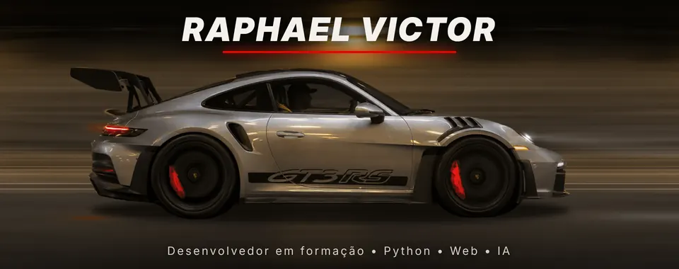

<p align="center">
  
</p>

<p align="center">
  <a href="https://www.linkedin.com/in/raphael-victor-gomes-lima-200b5a37a"></a>
  <a href="mailto:raphael.vgomeslima@gmail.com"></a>
  
</p>


##  Sobre o piloto

Sou estudante de **Análise e Desenvolvimento de Sistemas** no **CEUB** (Brasília) e gosto de transformar ideias em projetos reais — de **sites** e **sistemas web** a **bots** e **protótipos de jogos**.



<details>
<summary><b>🔧 Abrir a ficha técnica</b></summary>

```python
class Raphael(GT3RS):
    curso      = "Análise e Desenvolvimento de Sistemas @ CEUB"
    em_pista   = "Desenvolvendo o site da Peace Dove Vistos 🌐"
    motor      = ["Python", "JavaScript", "HTML/CSS"]
    crio       = ["Sites", "Bots de Discord com IA", "Sistemas de RPG", "Protótipos de jogos"]
    paixao     = ["Inteligência Artificial", "Jogos", "RPG", "Carros 🏎️"]
    disponivel = "Colaborações e freelas 🤝"
    redline    = 9000  # rpm
```

</details>


##  Garagem

<p align="center">
  
</p>

##  Central eletrônica (IA)

<p align="center">
  <b>💬 Modelos de linguagem</b><br><br>
  
  
  
  
  
  
</p>

<details>
<summary><b>🎨 Imagem, vídeo e música · 🔓 Open source</b></summary>
<br>
<p align="center">
  
  
  
  
  <br>
  
  
</p>
</details>


##  Grid de largada

| Pos. | Projeto | Descrição | Stack |
|:-:|:--|:--|:--|
| **P1** | 🕊️ **Peace Dove Vistos** | Site de uma assessoria de visto americano *(em desenvolvimento)* |    |
| **P2** | 🤖 **Bots de Discord** | Bots em Python com integração de IA |   |
| **P3** | 🎲 **Sistemas de RPG** | Sistemas de RPG que rodam no navegador |   |
| **P4** | 🧟 **Colheita Morta** | Protótipo de jogo de tiro top-down em pixel art com zumbis |  |
| **P5** | 👽 **Invasão Alien** | Jogo arcade desenvolvido em grupo na disciplina de POO |   |


##  Telemetria

<p align="center">
  
</p>

<p align="center">
  
</p>


<p align="center"><sub>Carro renderizado a partir do modelo 3D <a href="https://sketchfab.com/3d-models/porsche-gt3-rs-e738eae819c34d19a31dd066c45e0f3d">"Porsche GT3 RS"</a> de <a href="https://sketchfab.com/BlackSnow02">Black Snow</a>, licenciado sob <a href="http://creativecommons.org/licenses/by/4.0/">CC BY 4.0</a> (vidros e iluminação alterados).</sub></p>
