<p align="center">
  
</p>

<p align="center">
  <a href="https://www.linkedin.com/in/raphael-victor-gomes-lima-200b5a37a"></a>
  <a href="mailto:raphael.vgomeslima@gmail.com"></a>
  
</p>


##  Sobre mim

Sou estudante de **Análise e Desenvolvimento de Sistemas** no **CEUB** (Brasília) e gosto de transformar ideias em projetos reais — de **sites** e **sistemas web** a **bots** e **protótipos de jogos**.

```python
class Raphael:
    curso      = "Análise e Desenvolvimento de Sistemas @ CEUB"
    agora      = "Desenvolvendo o site da Peace Dove Vistos 🌐"
    crio       = ["Sites", "Bots de Discord com IA", "Sistemas de RPG", "Protótipos de jogos"]
    paixao     = ["Inteligência Artificial", "Jogos", "RPG"]
    disponivel = "Colaborações e freelas 🤝"
```


##  Tecnologias

<p align="center">
  
</p>

##  Inteligência Artificial

<p align="center">
  <b>💬 Modelos de linguagem</b><br><br>
  
  
  
  
  
  
</p>

<p align="center">
  <b>🎨 Imagem, vídeo e música</b><br><br>
  
  
  
  
</p>

<p align="center">
  <b>🔓 Open source</b><br><br>
  
  
</p>


##  Projetos em destaque

| Projeto | Descrição | Stack |
|:--|:--|:--|
| 🕊️ **Peace Dove Vistos** | Site de uma assessoria de visto americano *(em desenvolvimento)* |    |
| 🤖 **Bots de Discord** | Bots em Python com integração de IA |   |
| 🎲 **Sistemas de RPG** | Sistemas de RPG que rodam no navegador |   |
| 🧟 **Colheita Morta** | Protótipo de jogo de tiro top-down em pixel art com zumbis |  |
| 👽 **Invasão Alien** | Jogo arcade desenvolvido em grupo na disciplina de POO |   |


##  Estatísticas

<p align="center">
  
</p>


